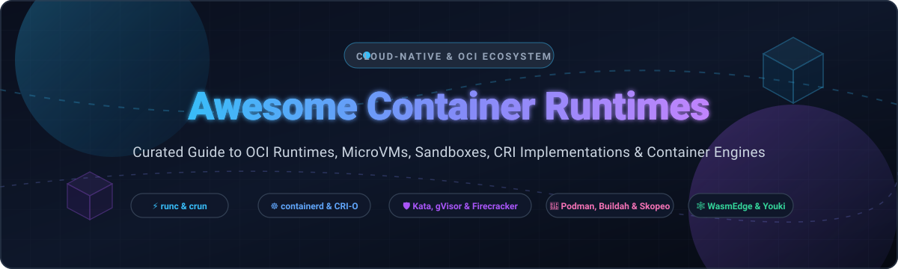

<<<<<<< HEAD
=======
# 📦 Awesome Container Runtimes 🚀

<div align="center">



<p align="center">
  <a href="https://github.com/ishandutta2007/Awesome-Awesome-Awesome"></a>
  <a href="https://discord.gg/jc4xtF58Ve"></a>
  <a href="https://github.com/ishandutta2007/Awesome-Container-Runtimes/stargazers"></a>
  <a href="https://github.com/ishandutta2007/Awesome-Container-Runtimes/network/members"></a>
  <a href="https://github.com/ishandutta2007/Awesome-Container-Runtimes/blob/main/LICENSE"></a>
  <a href="https://github.com/ishandutta2007"></a>
</p>

**A curated collection of production-grade Container Runtimes, OCI implementations, MicroVM hypervisors, sandboxed kernels, and Kubernetes CRI engines.**

*Last updated: October 2026*

</div>

---

## 📑 Table of Contents

- [🌐 Sector Overview & Market Dynamics](#-sector-overview--market-dynamics)
- [☁️ SaaS / Hosted Platforms](#️-saas--hosted-platforms)
- [⚡ Open-Source GitHub Projects](#-open-source-github-projects)
  - [Ranked by GitHub Stars](#ranked-by-github-stars)
- [🛠️ Architectural Taxonomy & Isolation Matrix](#️-architectural-taxonomy--isolation-matrix)
- [🤝 How to Contribute](#-how-to-contribute)
- [💖 Support & Community](#-support--community)
- [📈 Star History](#-star-history)
- [⚖️ Disclaimer](#️-disclaimer)

---

## 🌐 Sector Overview & Market Dynamics

The global containerization software and runtime ecosystem is estimated at approximately **$9.67 billion to $11.05 billion (2025–2026)**, expanding at a compound annual growth rate (CAGR) of ~17%. The market exhibits a distinct dual structure:

- **Core Low-Level Runtimes (Highly Concentrated / Winner-Take-All)**: Standardized strictly around CNCF and Open Container Initiative (OCI) specifications. Projects like `runc`, `containerd`, and `CRI-O` command nearly universal adoption in production Kubernetes clusters and container clouds.
- **Enterprise Platforms & Developer Ecosystems (Moderately Fragmented)**: Highly competitive across hyperscalers (Google GKE, Microsoft AKS, AWS EKS) and enterprise developer tooling (Docker, Red Hat Podman/OpenShift), with accelerating innovation in hardware-isolated microVMs (`Firecracker`, `Kata Containers`) and user-space sandboxes (`gVisor`) driven by untrusted multi-tenancy and AI/ML model execution security.

---

## ☁️ SaaS / Hosted Platforms

| 🚀 Platform | 🏢 Provider / Company | 💰 Company Size (Valuation / Revenue) | 📝 Description | 🏷️ Starting Tier Pricing | 🎁 Free Tier / Trial Limits |
| :--- | :--- | :--- | :--- | :--- | :--- |
| **Google Kubernetes Engine (GKE)** | Alphabet Inc. (Google) | ~$4.22 Trillion Market Cap / $350B+ Revenue | Managed Kubernetes platform shipping **containerd** by default, with native **gVisor (GKE Sandbox)** support. | $0.10/cluster/hour (~$74.40/month) for cluster management | $74.40/month billing credit covering 1 Zonal or Autopilot cluster indefinitely (compute/storage extra); plus $300 new-account credit (90-day trial). |
| **Azure Kubernetes Service (AKS)** | Microsoft Corporation | ~$4.01 Trillion Market Cap / $245B+ Revenue | Enterprise managed Kubernetes service utilizing **containerd** as standard node runtime. | $0.10/cluster/hour (~$73.00/month) for Standard Tier with financially-backed 99.95% SLA | Free Tier with $0/hour cluster management fee forever (limited to non-SLA, up to 1,000 nodes; compute/storage billed separately); plus $200 Azure credit (30-day trial). |
| **Amazon Elastic Kubernetes Service (Amazon EKS)** | Amazon.com, Inc. (AWS) | ~$2.75 Trillion Market Cap / $620B+ Revenue | Scalable managed Kubernetes control plane deploying **containerd** across EC2 and AWS Fargate workers. | $0.10/cluster/hour (~$73.00/month) for standard Kubernetes version support | No ongoing free tier credit for control plane management ($0.10/hr billed from creation); 12-month AWS Free Tier covers compute (750 hours/mo t2.micro/t3.micro), plus $300 AWS credits for eligible accounts. |
| **Docker Desktop** | Docker, Inc. | $2.1 Billion Valuation / ~$207M ARR | Desktop GUI and container environment (Docker Engine, Compose, Kubernetes) for macOS, Windows, and Linux. | $9.00/user/month (Pro plan billed annually) or $11.00/user/month billed monthly | Docker Personal tier is free forever for personal use, education, open source, or businesses with <250 employees AND <$10M gross annual revenue; 30-day free trial on paid commercial tiers. |

---

## ⚡ Open-Source GitHub Projects

### Ranked by GitHub Stars

All open-source container runtime repositories are sorted in descending order by GitHub stars. Star badges dynamically link to each repository's stargazers.

- **[Docker Engine (Moby)](https://github.com/moby/moby)** [](https://github.com/moby/moby/stargazers)  
  🐳 **The foundational container engine that launched modern containerization** (Apache-2.0)  
  Developer-favorite runtime featuring the industry-standard CLI, Dockerfile ecosystem, and Docker Compose tooling. Utilizes a multi-layer execution chain (`dockerd → containerd → containerd-shim → runc`). Ideal for workstation workflows, local CI/CD pipelines, and application building.

- **[Firecracker](https://github.com/firecracker-microvm/firecracker)** [](https://github.com/firecracker-microvm/firecracker/stargazers)  
  🔥 **Secure and fast microVMs for serverless computing** (Apache-2.0)  
  AWS's open-source minimalist virtual machine monitor written in Rust. Powers AWS Lambda and AWS Fargate, launching lightweight Linux microVMs in ~5ms with <5 MiB memory overhead. Replaces heavyweight QEMU device emulation with a stripped-down virtio interface for extreme density and security.

- **[Podman](https://github.com/containers/podman)** [](https://github.com/containers/podman/stargazers)  
  🦭 **Daemonless and rootless container and pod manager** (Apache-2.0)  
  Eliminates the single point of failure and security exposure of centralized daemon sockets (`/var/run/docker.sock`). Runs containers via direct fork-exec using Linux user namespaces. Native support for Kubernetes Pod syntax (`podman generate kube` and `podman play kube`), full Docker CLI aliasing, and 15–20% lower memory footprint.

- **[Colima](https://github.com/abiosoft/colima)** [](https://github.com/abiosoft/colima/stargazers)  
  🍏 **Container runtimes on macOS (and Linux) with minimal setup** (MIT)  
  Ultra-fast Docker Desktop replacement powered by Lima. Provides seamless macOS virtualization with Docker CLI, containerd, and Kubernetes integration, complete with port forwarding and volume mounts.

- **[Lima](https://github.com/lima-vm/lima)** [](https://github.com/lima-vm/lima/stargazers)  
  🐧 **Linux virtual machines on macOS with automatic file sharing and port forwarding** (Apache-2.0)  
  The de facto macOS VM layer for cloud-native engineers, enabling containerd, nerdctl, and Docker to run smoothly on Apple Silicon and Intel Macs with native VirtioFS acceleration.

- **[containerd](https://github.com/containerd/containerd)** [](https://github.com/containerd/containerd/stargazers)  
  ☸️ **The industry-standard container runtime core** (Apache-2.0, CNCF Graduated)  
  The default runtime powering GKE, EKS, AKS, and enterprise Kubernetes worldwide. Architected around decoupled shim processes that keep containers running uninterrupted even through daemon restarts. Features NRI (Node Resource Interface) 2.0 for dynamic GPU/CPU scheduling, pluggable snapshotters, Sandbox API for microVM isolation, and runwasi integration.

- **[gVisor](https://github.com/google/gvisor)** [](https://github.com/google/gvisor/stargazers)  
  🛡️ **Application kernel and syscall-interception sandbox for containers** (Apache-2.0)  
  Google's user-space kernel (Sentry) written in Go that acts as a secure boundary between untrusted containers and the Linux host kernel. Intercepts and executes syscalls in user space to eliminate kernel-level container escapes. Native Kubernetes integration via RuntimeClass (`runsc`), with zero hypervisor hardware requirements.

- **[runc](https://github.com/opencontainers/runc)** [](https://github.com/opencontainers/runc/stargazers)  
  ⚙️ **CLI tool for spawning and running containers according to the OCI specification** (Apache-2.0)  
  The universal, OCI-compliant low-level runtime written in Go. Directly interfaces with Linux cgroups, namespaces, and seccomp profiles. Serves as the bedrock execution engine inside containerd, CRI-O, Docker, and Podman.

- **[Skopeo](https://github.com/containers/skopeo)** [](https://github.com/containers/skopeo/stargazers)  
  🔭 **Work with remote container images and registry repositories** (Apache-2.0)  
  Utility that inspects, copies, signs, and syncs container images across registries and local storage without requiring root privileges or running container engines.

- **[WasmEdge](https://github.com/WasmEdge/WasmEdge)** [](https://github.com/WasmEdge/WasmEdge/stargazers)  
  🕸️ **High-performance, lightweight WebAssembly runtime for cloud-native and edge** (Apache-2.0, CNCF Sandbox)  
  OCI-compliant Wasm runtime designed to execute side-by-side with Linux containers via `crun` and `runwasi`. Delivers sub-millisecond cold starts and tiny footprints ideal for serverless, edge AI inference, and plugin architectures.

- **[nerdctl](https://github.com/containerd/nerdctl)** [](https://github.com/containerd/nerdctl/stargazers)  
  🤓 **Docker-compatible CLI for containerd** (Apache-2.0)  
  Full-featured CLI client for containerd with identical syntax to Docker, adding cutting-edge features: rootless mode, lazy pulling (eStargz, Nydus), OCIcrypt encryption, and IPFS image distribution.

- **[Buildah](https://github.com/containers/buildah)** [](https://github.com/containers/buildah/stargazers)  
  🏗️ **A tool that facilitates building OCI container images without a daemon** (Apache-2.0)  
  Builds standard OCI and Docker images rootlessly from scratch, standard shell scripts, or Dockerfiles without running background daemons or socket privileges.

- **[Bubblewrap](https://github.com/containers/bubblewrap)** [](https://github.com/containers/bubblewrap/stargazers)  
  🫧 **Unprivileged sandboxing tool for Linux containers and desktop isolation** (LGPL-2.0)  
  Low-level setuid implementation for creating unprivileged Linux namespaces and sandboxes, used as the containerization engine powering Flatpak.

- **[Kata Containers](https://github.com/kata-containers/kata-containers)** [](https://github.com/kata-containers/kata-containers/stargazers)  
  🔲 **Hardware-enforced VM-level isolation for containers** (Apache-2.0, OpenInfra Foundation)  
  Spawns lightweight virtual machines (via QEMU, Cloud Hypervisor, or Firecracker) for each container or pod, guaranteeing dedicated guest kernels. Delivers true multi-tenant security, PCI-DSS/FedRAMP isolation, and Confidential Containers support (Intel TDX, AMD SEV-SNP).

- **[Youki](https://github.com/containers/youki)** [](https://github.com/containers/youki/stargazers)  
  🦀 **A fast, memory-safe OCI container runtime written in Rust** (Apache-2.0)  
  Drop-in replacement for runc written in pure Rust. Achieves sub-300ms container cold starts with rigorous memory-safety guarantees, tailored for high-throughput FaaS environments and embedded Linux.

- **[Cloud Hypervisor](https://github.com/cloud-hypervisor/cloud-hypervisor)** [](https://github.com/cloud-hypervisor/cloud-hypervisor/stargazers)  
  ☁️ **Open source Virtual Machine Monitor (VMM) in Rust** (Apache-2.0)  
  Modern hypervisor focusing exclusively on cloud workloads and container isolation backends (backed by Intel and the Linux Foundation) built on rust-vmm components.

- **[CRI-O](https://github.com/cri-o/cri-o)** [](https://github.com/cri-o/cri-o/stargazers)  
  🎯 **Lightweight, Kubernetes-dedicated Container Runtime Interface** (Apache-2.0, CNCF Graduated)  
  Engineered exclusively for Kubernetes CRI without legacy Docker overhead. The default runtime for Red Hat OpenShift, synchronized 1:1 with upstream Kubernetes releases. Consumes ~50 MB memory overhead per node with sub-100ms startup latencies.

- **[crun](https://github.com/containers/crun)** [](https://github.com/containers/crun/stargazers)  
  🏎️ **Ultra-fast, lightweight OCI runtime written in C** (GPL-2.0)  
  High-performance alternative to runc with ultra-low memory footprint (~2 MB) and instant execution. The default low-level runtime for Podman and modern CRI-O distributions, featuring built-in WebAssembly engine dispatching.

- **[OCI Image Specification](https://github.com/opencontainers/image-spec)** [](https://github.com/opencontainers/image-spec/stargazers)  
  📄 **The official OCI Image Format Specification** (Apache-2.0)  
  Defines the vendor-neutral specifications for layered container filesystem serialization, manifests, config descriptors, and cryptographic index schemas.

- **[OCI Runtime Specification](https://github.com/opencontainers/runtime-spec)** [](https://github.com/opencontainers/runtime-spec/stargazers)  
  📜 **The official OCI Container Runtime Specification** (Apache-2.0)  
  Standardizes container lifecycle hooks, configuration schemas (`config.json`), execution environments, and syscall restrictions across low-level engines.

- **[crictl (CRI Tools)](https://github.com/kubernetes-sigs/cri-tools)** [](https://github.com/kubernetes-sigs/cri-tools/stargazers)  
  🔧 **CLI and validation test suite for Kubelet CRI runtimes** (Apache-2.0)  
  Standard debugging and operational CLI for inspecting pods, sandboxes, and images directly across CRI runtimes without going through the Kubernetes API server.

- **[runwasi](https://github.com/containerd/runwasi)** [](https://github.com/containerd/runwasi/stargazers)  
  🧩 **WebAssembly containerd shims** (Apache-2.0)  
  CNCF project providing shims for containerd to run Wasm modules natively through Wasmtime, WasmEdge, and Spin alongside Linux containers.

- **[Uservm / Rootless Containers (Usernetes)](https://github.com/rootless-containers/usernetes)** [](https://github.com/rootless-containers/usernetes/stargazers)  
  🛡️ **Kubernetes multi-node cluster running entirely under unprivileged user namespaces** (Apache-2.0)  
  Proves total rootless isolation by deploying Kubernetes CRI runtimes and control planes without root privileges.

- **[containers/image](https://github.com/containers/image)** [](https://github.com/containers/image/stargazers)  
  🖼️ **Go library for transporting and converting container images** (Apache-2.0)  
  The core image pulling, verifying, and signing library powering Podman, Skopeo, and CRI-O.

- **[umoci](https://github.com/opencontainers/umoci)** [](https://github.com/opencontainers/umoci/stargazers)  
  🔨 **Modifies Open Container Initiative (OCI) images as unprivileged user** (Apache-2.0)  
  Tool for unpacking, modifying, and repacking compliant OCI images without requiring root permissions.

- **[Netavark](https://github.com/containers/netavark)** [](https://github.com/containers/netavark/stargazers)  
  🌐 **Rust-based container network stack** (Apache-2.0)  
  High-performance container networking stack configuration tool and CNI replacement for Podman and rootless environments.

- **[containers/storage](https://github.com/containers/storage)** [](https://github.com/containers/storage/stargazers)  
  💾 **Go library for managing local filesystem layers and overlay storage** (Apache-2.0)  
  Shared storage backend for layered container graph drivers (overlay2, btrfs, vfs) utilized across the Podman/CRI-O stack.

- **[conmon](https://github.com/containers/conmon)** [](https://github.com/containers/conmon/stargazers)  
  👀 **OCI container monitor written in C** (Apache-2.0)  
  Lightweight monitor daemon tracking container exit statuses, TTY forwardings, and log streams for Podman and CRI-O.

---

## 🛠️ Architectural Taxonomy & Isolation Matrix

```
                      +------------------------------------------+
                      |         Developer & Management CLI       |
                      |   Docker CLI  |  Podman  |  nerdctl      |
                      +------------------------------------------+
                                           |
                      +------------------------------------------+
                      |          High-Level CRI Runtimes         |
                      |         containerd    |    CRI-O         |
                      +------------------------------------------+
                                           |
               +---------------------------+---------------------------+
               |                           |                           |
      +------------------+       +-------------------+       +-------------------+
      |   Standard OCI   |       |   Syscall Sandbox |       |   MicroVM / VM    |
      |   runc / crun    |       |       gVisor      |       |  Kata / Firecracker|
      +------------------+       +-------------------+       +-------------------+
               |                           |                           |
        (Shared Kernel)             (Emulated Kernel)          (Hardware Isolation)
```

| Runtime Type | Projects | Isolation Boundary | Startup Latency | Overhead | Primary Best Use Case |
| :--- | :--- | :--- | :--- | :--- | :--- |
| **Traditional OCI** | `runc`, `crun`, `youki` | Linux Namespaces + cgroups | ~50–150 ms | Minimal (<10 MB) | Standard trusted workloads, high density |
| **User-Space Kernel** | `gVisor` (runsc) | Syscall Interception (Sentry) | ~100–250 ms | Low (~20 MB) | Untrusted user code, multi-tenant SaaS |
| **MicroVM Hypervisor** | `Kata Containers`, `Firecracker` | KVM / Hardware Virtualization | ~120–300 ms | Moderate (~30 MB) | Regulatory multi-tenancy, AI models, FedRAMP |
| **WebAssembly Engine**| `WasmEdge`, `runwasi` | Wasm Bytecode Sandbox | <5 ms | Ultra-low (<5 MB) | Edge computing, serverless plugins |

---

## 🤝 How to Contribute

Contributions are welcome! Please help keep this container runtime index comprehensive, factual, and up to date.

1. 🍴 Fork the repository.
2. 🌿 Create a descriptive feature branch (`git checkout -b add-runtime-entry`).
3. ✏️ Add or update entries following the established format and alphabetical/category sorting.
4. 🔍 Ensure all links, descriptions, and license tags are accurate.
5. 🚀 Submit a Pull Request with a clear explanation of the addition.

---

## 💖 Support & Community

If you find this curated ecosystem list helpful for your platform engineering, devops, or security infrastructure projects, please consider supporting the project:

- ⭐ **Star this repository** to improve visibility and help other cloud-native developers find it.
- 🍴 **Fork and share** the project with your platform engineering team and community.
- 💬 **Join our community on [Discord](https://discord.gg/jc4xtF58Ve)** to discuss container security, runtimes, and cloud-native architecture.
- ☕ **Sponsor & Buy a Coffee**: If you'd like to support continued maintenance and curation of open cloud-native tools, visit our **[GitHub Sponsors Dashboard](https://github.com/sponsors/ishandutta2007)**.

*Thank you to all contributors, maintainers, and sponsors who make open-source container infrastructure thrive!*

---

## 📈 Star History

[](https://star-history.dera.page/#ishandutta2007/Awesome-Container-Runtimes&type=date&legend=top-left)

---

## ⚖️ Disclaimer

- This is a community-curated directory intended for research, educational, and platform engineering purposes. It is not an endorsement.
- Container isolation acts as your foundational security boundary. Select runtimes based on your precise threat model (e.g., standard internal services vs. hostile user workloads requiring hypervisor-level isolation).
>>>>>>> d62af97d18b2828d18f2b0412ae62fd65b2e0c0e
# Awesome-Container-Runtimes

